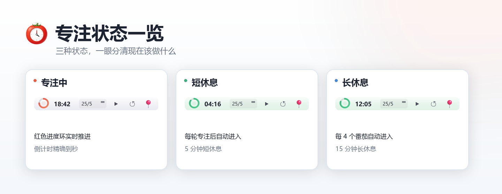

<div align="center">

#  任务栏番茄钟

**常驻任务栏的极简番茄工作法工具 —— 专注与休息，抬眼即见。**

基于 PySide6，跨平台支持 **Windows / macOS / Linux**。Windows 常驻任务栏上方，macOS 常驻顶部菜单栏（显示倒计时），Linux 为置顶小窗 / AppImage。

[English README](README_EN.md) · [](https://www.microsoft.com/windows) [](https://www.python.org/) [](LICENSE)

</div>


## 为什么用它？

大多数番茄钟是一个独立窗口——你需要把它切到前台，然后它会盖住正在做的工作。
**任务栏番茄钟** 换了一种思路：把自己嵌进任务栏，成为桌面的一部分。

| 痛点 | 本项目的做法 |
|------|------------|
| 番茄钟窗口挡住工作区 | 常驻任务栏，与系统任务栏**同高**，不占用桌面空间 |
| 一开全屏/其他窗口就看不见 | Win32 `HWND_TOPMOST` **始终置顶**，任何窗口都无法遮挡 |
| 多显示器拖动后界面变形 | 基于 Qt6 原生逻辑像素 + `screenChanged` 监听，**跨屏/跨 DPI 自动重排** |
| 计时器切走后走时不准 | 采用**单调时钟绝对时间戳**，系统卡顿或休眠唤醒后自动追平，不漂移 |
| 换主题就要重来 | 切换主题、语言、音效时**计时不中断**，剩余时间与轮次原样保留 |
| 打包工具动辄上百 MB | 仅依赖 PySide6，**EXE 约 44MB**；提供安装版 + 绿色版 |
| 需要安装一堆音频库 | 直接调用系统播放器（Windows MCI / macOS `afplay` / Linux `paplay`），**零第三方音频依赖** |
| 界面千篇一律 | **5 种主题**一键切换（深空/浅色/番茄红/森林绿/iOS） |
| 提示音不能换 | **16 种音效**自选，开始/结束分别设置；默认开始上行、结束下行 |

## 功能特性



- **任务栏融合**：半透明玻璃质感 UI + 实时进度圆环，窗口高度自适应任务栏
- **始终置顶**：主窗口常驻顶层；打开设置/统计/下拉菜单时智能暂停刷新，避免遮挡弹出层
- **拖拽与锁定**：可拖动到任意位置；`📍` 一键锁定，防止误触移动
- **完整番茄工作法**：专注 → 短休息 → …… → **每 4 个番茄自动进入长休息**（时长与轮数均可配置）
- **精准计时**：单调时钟驱动，杜绝累计误差；暂停后续接无偏差
- **连续专注模式**：工作与休息自动循环，直到手动暂停
- **5 种主题**：经典深空 / 清爽浅色 / 番茄红 / 森林绿 / iOS 现代风，**切换即时生效且不打断计时**
- **多国语言**：简体中文 / English / 日本語，可跟随系统或手动选择；**切换语言同样不打断计时**
- **🍅 番茄图标**：窗口、托盘、设置/历史对话框、EXE、安装包统一使用番茄闹钟图标（原图见 `assets/番茄钟图标_原始.png`）
- **16 种可选音效**：14 种代码合成 + 2 种方向音效；**开始/结束音效分别可选**，默认「上行提示」+「下行提示」，一听就知道是开始还是结束
- **系统托盘**：托盘菜单可开始/暂停、查看历史、今日统计、显隐窗口、开机自启
- **数据本地化**：设置与历史全部保存在本机，不联网、不上传

## 快速开始

### 方式一：直接运行（推荐开发者）

```bash
# 1. 安装依赖
pip install -r requirements.txt

# 2. 运行
python main.py
```

### 方式二：下载现成版本（推荐）

从 [Releases](../../releases) 下载对应平台的安装包，均无需 Python 环境：

| 平台 | 文件 | 说明 |
|------|------|------|
| Windows | `PomodoroTaskbar_安装版_vX.X.X.exe` | 双击安装到用户目录，自动建快捷方式，无需管理员权限，可卸载 |
| Windows | `PomodoroTaskbar_绿色版_vX.X.X.zip` | 解压即用，删除文件夹即卸载（内含番茄图标原图） |
| macOS | `PomodoroTaskbar_macOS.zip` | 解压得到 `.app`，拖进「应用程序」即可；菜单栏常驻显示倒计时 |
| Linux | `PomodoroTaskbar_Linux_x86_64.AppImage` | 赋可执行权限后双击运行，免安装、跨发行版 |

> macOS 首次打开：因未做开发者签名，需在「访达」中右键 → 打开（或系统设置 → 隐私与安全性 → 仍要打开）。

### 打包

```bash
python build_all.py     # 跨平台（Win/Mac/Linux 通用）
build.bat               # Windows 专用
```

产物位于 `dist/`。构建脚本剔除了 PySide6 中未使用的 WebEngine、QML、3D、Charts 等模块以控制体积。三平台安装包由 GitHub Actions 在推送 `v*` 标签时自动构建并发布到 Releases。

## 使用说明

1. 启动后窗口出现在任务栏区域（默认屏幕右侧）
2. `▶` 开始 / `⏸` 暂停，`↺` 重置；`📍` 锁定窗口（禁止拖动）/ `🔓` 解锁
3. 下拉框切换预设时长；**右键窗口**打开菜单（连续专注、今日统计、设置、历史等）
4. 双击托盘图标可快速开始 / 暂停
5. 设置 → 选项 → **界面语言**：跟随系统 / 简体中文 / English / 日本語，选择后立即生效

### 预设与自定义

- 内置预设：`5/1`、`15/5`、`25/5`、`30/5`（专注/短休息，分钟）
- 设置中可自定义：专注时长、短休息、长休息时长、每几轮进入长休息、开机自启、提示音开关、界面主题、界面语言

### 音效规则

在 设置 → 声音设置 中，可分别为「开始 / 下一轮」和「专注结束」挑选音效，共 16 种：

| 时机 | 使用设置项 | 默认音效 |
|------|------------|----------|
| 开始专注 / 休息结束后进入下一轮 | 开始音效 | 上行提示（音高由低到高） |
| 专注结束 | 结束音效 | 下行提示（音高由高到低） |
| 休息结束且未开启连续专注 | 无 | — |

其余音效包含 12 种合成音与 4 种 mixkit 免费音效，可自由混搭。老版本配置会自动升级为新的默认音效对。

### 配置与数据位置

- 设置：`%APPDATA%\PomodoroTaskbar\settings.ini`
- 历史：`%APPDATA%\PomodoroTaskbar\history.json`
- 异常日志：`%APPDATA%\PomodoroTaskbar\crash.log`（仅在出错时生成，可反馈给开发者）

所有数据仅存于本机，不会上传到任何服务器。

## 技术栈

- **PySide6**：跨平台 GUI 框架（仅用 QtWidgets / QtCore / QtGui）
- **i18n.py**：轻量多语言层，英文原文作 key，内置中/英/日三套文案，支持「跟随系统」
- **platform_utils.py**：平台差异统一层 —— 置顶（Win32 / Qt 原生）、音效（MCI / afplay / paplay）、开机自启（注册表 / launchd / XDG）
- **Win32 API**（仅 Windows，`ctypes`）：`SetWindowPos` 置顶、扩展窗口样式、任务栏高度计算
- **PyInstaller**：三平台打包（Windows EXE / macOS .app / Linux ELF→AppImage）
- **GitHub Actions**：推送 `v*` 标签时自动构建三平台安装包并发布到 Releases

## 项目结构

```
.
├── main.py              # 入口、应用逻辑、音效与通知
├── i18n.py              # 多语言字典与切换逻辑
├── diagnostics.py       # 本地崩溃日志与槽函数异常兜底
├── app_icon.py          # 全局唯一番茄图标源（窗口/托盘/对话框统一）
├── platform_utils.py    # 平台差异层：置顶/音效/开机自启（三平台）
├── appbar_window.py     # 任务栏窗口、进度环、拖动/置顶/跨屏自适应
├── timer_logic.py       # 计时状态机（单调时钟 + 长休息）
├── settings.py          # 设置管理与设置对话框
├── tray_icon.py         # 系统托盘与右键菜单
├── history_manager.py   # 历史记录读写与统计
├── history_dialog.py    # 历史记录对话框
├── theme.py             # 5 套主题配色定义
├── sounds.py            # 16 种音效注册表
├── sound/               # 提示音文件（合成 WAV + mixkit MP3）
├── tools/               # 音效生成脚本
├── assets/              # 番茄闹钟图标（app.ico / tomato.png / 原始图留档）
├── installer.iss        # Inno Setup 安装版脚本（免管理员，Windows）
├── build_all.py         # 跨平台打包脚本（Win/Mac/Linux 通用）
├── build.bat            # Windows 专用打包脚本
├── .github/workflows/   # GitHub Actions 三平台自动构建配置
│   └── release.yml
├── docs/images/         # README 白底配图（真实软件截图）+ 生成脚本
├── tests/               # 计时状态机单元测试
├── requirements.txt
├── README.md            # 中文说明
└── README_EN.md         # English README
```

### 运行测试

```bash
python -m unittest tests.test_timer_logic
```

测试覆盖初始状态、时长切换、长休息间隔、计时防漂移、暂停续接等核心逻辑。

## 注意事项

- **Windows 10 / 11**：窗口常驻任务栏上方，置顶依赖 Win32 `SetWindowPos(HWND_TOPMOST)`
- **macOS**：常驻顶部菜单栏显示倒计时，点菜单可展开；未做开发者签名，首次需右键打开
- **Linux**：推荐 AppImage；需系统有 `paplay`/`aplay` 之一播放提示音（多数发行版自带）
- 音效零第三方依赖：Windows 用系统 MCI，macOS 用 `afplay`，Linux 用 `paplay`/`aplay`
- 设置与历史存于本机用户目录（Win: `%APPDATA%` / Mac: `~/Library/Application Support` / Linux: `~/.config`），换电脑不会带走

## License

[MIT](LICENSE) © Yisen-Yang
