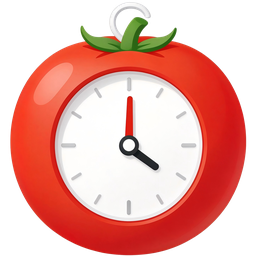
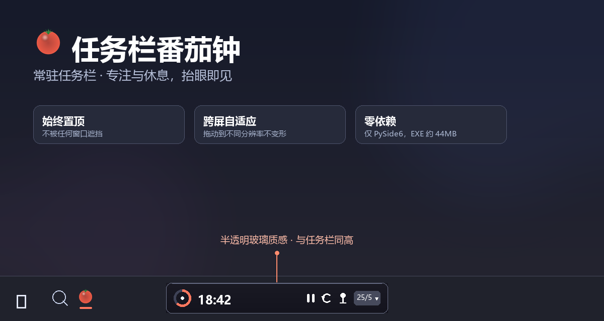
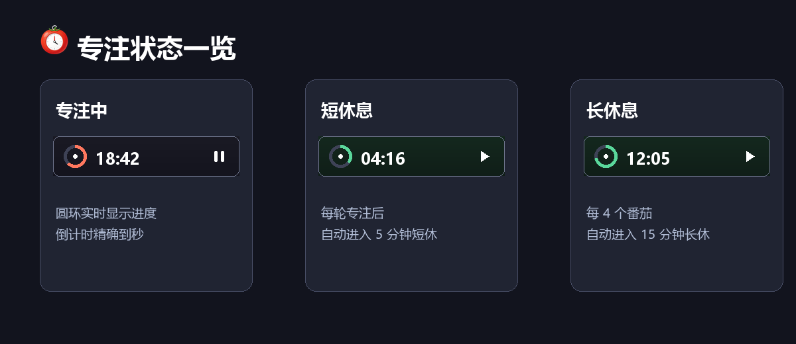

<div align="center">

#  Taskbar Pomodoro

**A minimalist Pomodoro timer that lives in your taskbar — focus and breaks, always in sight.**

Built with PySide6 for **Windows / Linux**. On Windows it sits on the taskbar; on Linux it is an always-on-top mini window shipped as an AppImage.

[中文说明](README.md) · [](https://www.microsoft.com/windows) [](https://www.linux.org/) [](https://www.python.org/) [](LICENSE)

</div>



## Why this one?

Most Pomodoro apps open a separate window. You bring it to the front, and it covers the work you are trying to do.
**Taskbar Pomodoro** takes a different approach: it becomes part of the taskbar itself.

| Problem | How this project solves it |
|---------|----------------------------|
| The timer window covers my work | Sits on the taskbar at **exactly taskbar height**, using no desktop space |
| It disappears when I go fullscreen | Win32 `HWND_TOPMOST` keeps it **always on top** |
| It breaks after dragging across monitors | Qt6 logical pixels + `screenChanged`, **auto-relayout across DPI screens** |
| Time drifts after sleep or lag | **Monotonic absolute deadline**, automatically catches up after wake |
| Changing the theme resets my timer | Theme, language and sound changes **never interrupt the running timer** |
| The installer is hundreds of MB | Only PySide6 is required, **EXE is about 44 MB**; installer + portable builds |
| I need extra audio libraries | Uses the OS player (Windows MCI / Linux `paplay`), **no third-party audio deps** |
| Every UI looks the same | **5 built-in themes** (deep space / light / tomato red / forest / iOS) |
| I cannot change the alert sound | **16 selectable sounds**, separate start/end choices; defaults rise then fall |

## Features



- **Taskbar fusion**: translucent glass UI with a live progress ring, height matched to the taskbar
- **Always on top**: the window stays above other windows; popups intelligently suspend the pinning loop
- **Drag and lock**: move it anywhere; click `📍` to lock it in place
- **Complete Pomodoro flow**: focus → short break → … → **long break every 4 tomatoes** (all durations configurable)
- **Accurate timing**: monotonic clock, no accumulated error, seamless resume after pause
- **Continuous focus**: work and breaks loop automatically until you pause manually
- **5 themes**: apply instantly **without stopping the timer**
- **Multiple languages**: Simplified Chinese / English / Japanese, follow system or choose manually — **switching also keeps the timer running**
- **🍅 Tomato icon**: window, tray, dialogs, EXE and installer all use the same tomato alarm-clock icon (original image in `assets/番茄钟图标_原始.png`)
- **16 sounds**: 14 synthesized + 2 directional ones; default **ascending** for start and **descending** for end, so you can tell them apart instantly
- **System tray**: start/pause, history, today's stats, show/hide window, run at startup
- **Local-only data**: settings and history stay on this machine; no network, no uploads
- **Refined UI 2.0**: compact context / tray menus, distinct purple long-break and locked outline, flat section dividers with 5 theme swatches in settings
- **7-day trend**: a bar chart in history for a quick read on focus time, all from local data
- **Installer**: choose UI language at install time; reinstalling upgrades in place and keeps your data

## Quick start

### Option 1: Run from source

```bash
pip install -r requirements.txt
python main.py
```

### Option 2: Download a build

Grab a package for your platform from [Releases](../../releases); no Python installation needed.

| Platform | File | Notes |
|----------|------|-------|
| Windows | `PomodoroTaskbar_Setup_vX.X.X.exe` | Installs to the user directory, no admin rights, shortcuts and uninstaller included; choose language at install, upgrades in place |
| Windows | `PomodoroTaskbar_Portable_vX.X.X.zip` | Portable; unzip and run, delete the folder to uninstall (includes the original icon) |
| Windows | `PomodoroTaskbar.exe` | Single-file standalone executable, run by double-clicking |
| Linux | `PomodoroTaskbar_Linux_x86_64.AppImage` | Make executable and run; no installation, works across distros |

### Building

```bash
python build_all.py     # Windows / Linux
build.bat               # Windows only
```

Output goes to `dist/`. The build scripts exclude unused PySide6 modules (WebEngine, QML, 3D, Charts, …) to keep the size small. Pushing a `v*` tag makes GitHub Actions build and publish both platform packages.

## Usage

1. On launch the window appears near the taskbar (right side by default)
2. `▶` start / `⏸` pause, `↺` reset; `📍` lock the window (prevents dragging) / `🔓` unlock
3. Use the dropdown for presets; **right-click the window** for continuous focus, today's stats, settings and history
4. Double-click the tray icon to start / pause quickly
5. Settings → Options → **Language**: Follow system / 简体中文 / English / 日本語, applied immediately

### Presets and customization

- Built-in presets: `5/1`, `15/5`, `25/5`, `30/5` (focus / short break, minutes)
- Settings let you change focus, short break and long break durations, long-break interval, startup behavior, sound toggle, theme and language

### Sound rules

In Settings → Sound you can pick separate sounds for "Start / next round" and "Focus end" from 16 options:

| Moment | Setting | Default |
|--------|---------|---------|
| Start focus / next round after a break | Start sound | Ascending chime (low → high) |
| Focus ends | End sound | Descending chime (high → low) |
| Break ends without continuous focus | None | — |

The other sounds include 12 synthesized tones and 4 free mixkit effects, and can be mixed freely. Old configurations are migrated to the new default pair automatically.

### Config and data locations

- Settings: `%APPDATA%\PomodoroTaskbar\settings.ini`
- History: `%APPDATA%\PomodoroTaskbar\history.json`
- Error log: `%APPDATA%\PomodoroTaskbar\crash.log` (created only after an error; useful for bug reports)

All data stays on this machine and is never uploaded.

## Tech stack

- **PySide6**: GUI (QtWidgets / QtCore / QtGui only)
- **i18n.py**: lightweight language layer keyed by English source text, with Chinese / English / Japanese dictionaries and "follow system" support
- **platform_utils.py**: platform abstraction — pinning (Win32 / Qt), sound (MCI / paplay), autostart (registry / XDG)
- **Win32 API** (Windows only, via `ctypes`): `SetWindowPos` pinning, extended window styles, taskbar height detection
- **PyInstaller**: two-platform packaging (Windows EXE / Linux ELF → AppImage)
- **GitHub Actions**: pushing a `v*` tag builds and publishes all packages to Releases

## Project structure

```
.
├── main.py              # Entry point, app logic, sounds and notifications
├── i18n.py              # Translation dictionaries and switching logic
├── diagnostics.py       # Local crash log and safe slot wrappers
├── app_icon.py          # Single source of truth for the tomato icon
├── platform_utils.py    # Platform layer: pinning / sound / autostart
├── appbar_window.py     # Taskbar window, progress ring, drag / pin / DPI
├── timer_logic.py       # Timer state machine (monotonic clock + long breaks)
├── settings.py          # Settings manager and dialog
├── tray_icon.py         # System tray and context menu
├── history_manager.py   # History storage and statistics
├── history_dialog.py    # History dialog
├── theme.py             # 5 color themes
├── ui_style.py          # Shared QSS for menus and settings
├── sounds.py            # Registry of 16 sounds
├── sound/               # Sound files (synth WAV + mixkit MP3)
├── tools/               # Sound generation script
├── assets/              # Tomato alarm-clock icons
├── installer.iss        # Inno Setup script (per-user install, no admin)
├── build_all.py         # Two-platform build script
├── build.bat            # Windows build script
├── .github/workflows/   # GitHub Actions for two platforms
│   └── release.yml
├── docs/images/         # README screenshots + installer artwork
├── docs/design/         # Interactive UI 2.0 design preview (HTML)
├── tests/               # Timer state machine tests
├── requirements.txt
├── README.md            # 中文说明
└── README_EN.md         # This file
```

### Running tests

```bash
python -m unittest tests.test_timer_logic
```

Tests cover initial state, duration changes, long-break interval, drift resistance and pause/resume.

## Notes

- **Windows 10 / 11**: the window sits on the taskbar and relies on `SetWindowPos(HWND_TOPMOST)`
- **Linux**: AppImage recommended; needs `paplay` or `aplay` to play sounds (present on most distributions)
- Sound playback uses the OS player only: MCI on Windows, `paplay`/`aplay` on Linux
- Settings and history are stored under the user directory (Win: `%APPDATA%` / Linux: `~/.config`); they do not follow you to another machine

## License

[MIT](LICENSE) © Yisen-Yang
